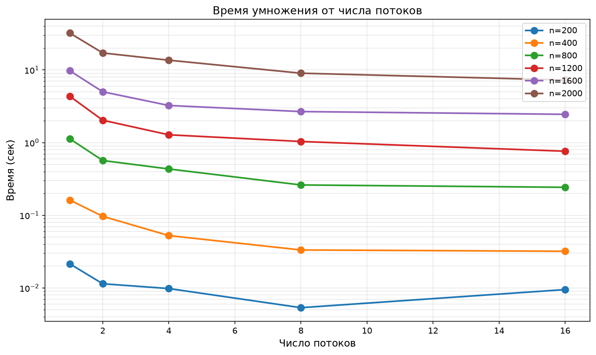
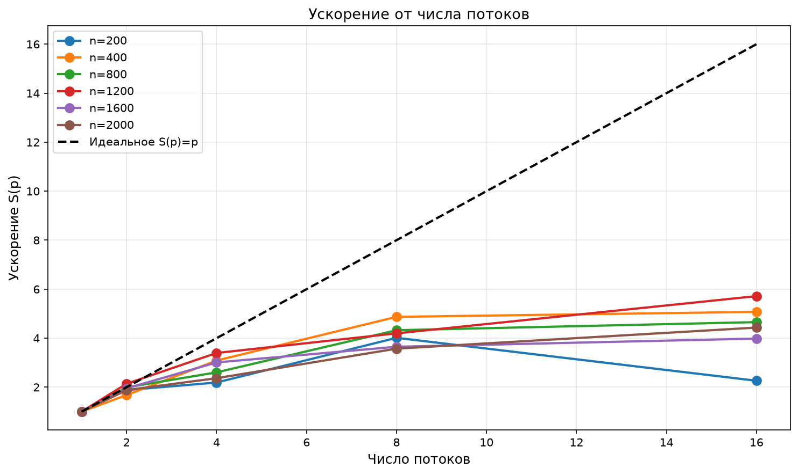
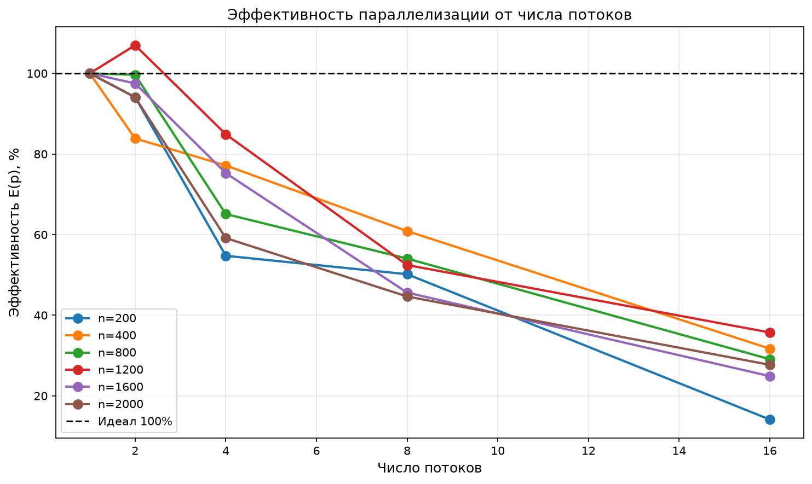
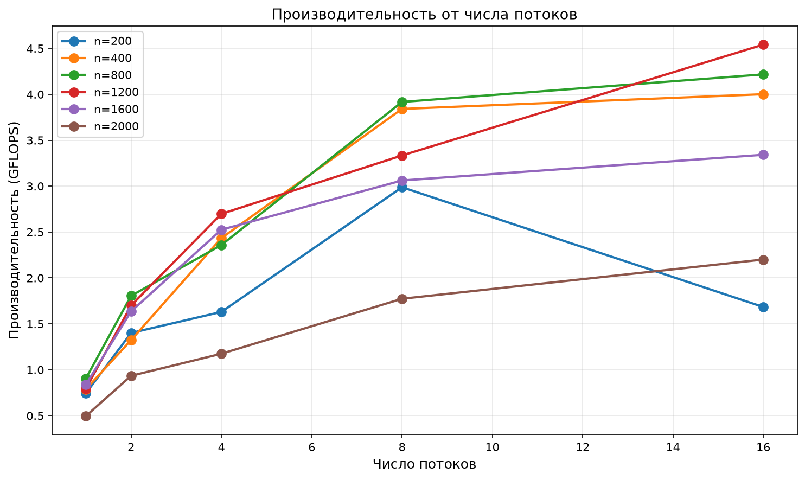

Лабораторная работа по параллельному программированию №2.
Выполнено Кирсановой Ириной, 6212-100503D.

***
# Структура проекта
```
lab2/
├── .gitignore
├── README.md
│
├── data/                          # исходные матрицы (txt)
│   ├── matrix_a_200.txt
│   ├── matrix_b_200.txt
│   └── ...
│
├── results/                       # результаты умножения (txt)
│   ├── result_200.txt
│   └── ...
│
├── run_results/                   # результаты экспериментов
│   ├── timings.csv                # данные запусков
│   ├── graph1_time_vs_threads.png # время от потоков
│   ├── graph2_speedup.png         # ускорение от потоков
│   ├── graph3_efficiency.png      # эффективность от потоков
│   └── graph4_gflops.png          # производительность (GFLOPS)
│
├── generator.py                   # генератор матриц
├── main.cpp                       # умножение матриц на C++ с OpenMP
├── run.py                         # запуск и проверка точности через NumPy
├── grafs.py                       # построение графиков
└── table.py                       # генерация таблицы для отчёта
```

***
# **Характеристики:**

- **CPU**:  AMD Ryzen 7 H 255

- **Оперативная память**:  16 гб DDR5 5600 MHz

- **Накопитель**:  SSD 1024 гб

- **ОС**:  Windows 11 Pro, 64-bit

- **Компилятор C++**:  MSVC (Microsoft Visual C++) Version 19.51.36260 for x64

- **Python**:  3.14.7
***

# **Суть работы:**

Модифицировать программу умножения квадратных матриц из лабораторной работы №1 для параллельной работы по технологии OpenMP. Провести серию экспериментов с разным количеством потоков и разными размерами матриц.

При данных матрицах A и B ∈ $R^{n×n}$ вычислить матрицу C, которая будет вычисляться по формуле:
$$C_{ij} = \sum_{k=1}^{n} A_{ik} \cdot B_{kj}$$

Для оценки эффективности параллелизации используются:
$$S(p) = \frac{T_1}{T_p} \quad \text{— ускорение}$$
$$E(p) = \frac{S(p)}{p} \times 100\% \quad \text{— эффективность}$$

где $T_1$ — время на 1 потоке, $T_p$ — время на $p$ потоках.

***
# **Модификации по сравнению с лабой №1**

1. В `main.cpp` добавлена директива OpenMP для распараллеливания внешнего цикла по `i`:
   ```cpp
   #pragma omp parallel for
   for (int i = 0; i < n; ++i) { ... }
   ```
2. Число потоков передаётся вторым аргументом командной строки:
   ```bash
   .\main.exe 800 4
   ```
3. Сборка выполняется с флагом `/openmp`:
   ```bash
   cl /EHsc /utf-8 /std:c++23preview /O2 /openmp main.cpp
   ```
4. `run.py` перебирает пары (размер, число потоков) и делает по 3 запуска на каждую.

***

# **Порядок проведения экспериментов**
1. Сгенерировать две матрицы размером n×n (200, 400, 800, 1200, 1600, 2000) с помощью скрипта generator.py, записать в два файла формата txt.
2. Запустить скрипт run.py, который переберёт все комбинации размер × потоки (1, 2, 4, 8, 16) и сделает по 3 запуска на каждую. На каждом запуске запускается таймер, который в конце покажет, сколько времени ушло на выполнение всей программы (в том числе на чтение файлов и т.д.).
3. main.cpp прочитает матрицы из файлов и перемножит их, запишет результат в txt файл в папке results. Также запустит таймер, который засечёт время выполнения алгоритма. Программу можно запустить отдельно командой `.\main.exe (размер матрицы) (число потоков)` — тогда она произведёт расчёт только для заданной комбинации и выведет в терминал время выполнения, количество операций ($2n^3$) и адрес файла с результатом.
4. NumPy также посчитает произведение матриц, и полученный результат будет сравниваться с результатом выполнения main. Посчитается абсолютная разница (1) и относительная погрешность (2) по формулам:

$$\Delta_{ij} = |C_{cpp}[i][j] - C_{numpy}[i][j]| \quad(1)$$

$$\delta_{ij} = \frac{|C_{\text{cpp}}[i][j] - C_{\text{numpy}}[i][j]|}{\max(|C_{\text{numpy}}[i][j]|, 1)} \quad(2)$$

Все отчёты выводятся в терминал и записываются в файл timings.csv (папка run_results).

---
# **Результаты экспериментов**

| Размер | Потоки | Время Python (сек) | Время C++ (сек) | Операций | Нс/операцию | Ускорение | Эффективность | Проверка |
|---|---|---|---|---|---|---|---|---|
| 200 | 1 | 0.2577 | 0.021496 | 16 000 000 | 1.3435 | 1.00 | 100.0% | OK |
| 200 | 2 | 0.1361 | 0.011422 | 16 000 000 | 0.7139 | 1.88 | 94.1% | OK |
| 200 | 4 | 0.1227 | 0.009816 | 16 000 000 | 0.6135 | 2.19 | 54.7% | OK |
| 200 | 8 | 0.1305 | 0.005355 | 16 000 000 | 0.3347 | 4.01 | 50.2% | OK |
| 200 | 16 | 0.1322 | 0.009501 | 16 000 000 | 0.5938 | 2.26 | 14.1% | OK |
| 400 | 1 | 0.5111 | 0.162294 | 128 000 000 | 1.2679 | 1.00 | 100.0% | OK |
| 400 | 2 | 0.4462 | 0.096774 | 128 000 000 | 0.7560 | 1.68 | 83.9% | OK |
| 400 | 4 | 0.3530 | 0.052588 | 128 000 000 | 0.4108 | 3.09 | 77.2% | OK |
| 400 | 8 | 0.3113 | 0.033325 | 128 000 000 | 0.2604 | 4.87 | 60.9% | OK |
| 400 | 16 | 0.2689 | 0.031990 | 128 000 000 | 0.2499 | 5.07 | 31.7% | OK |
| 800 | 1 | 1.8453 | 1.130508 | 1 024 000 000 | 1.1040 | 1.00 | 100.0% | OK |
| 800 | 2 | 1.2585 | 0.567296 | 1 024 000 000 | 0.5540 | 1.99 | 99.6% | OK |
| 800 | 4 | 1.1963 | 0.434103 | 1 024 000 000 | 0.4239 | 2.60 | 65.1% | OK |
| 800 | 8 | 1.0060 | 0.261421 | 1 024 000 000 | 0.2553 | 4.32 | 54.1% | OK |
| 800 | 16 | 1.0387 | 0.242815 | 1 024 000 000 | 0.2371 | 4.66 | 29.1% | OK |
| 1200 | 1 | 5.9979 | 4.350063 | 3 456 000 000 | 1.2587 | 1.00 | 100.0% | OK |
| 1200 | 2 | 3.3938 | 2.033160 | 3 456 000 000 | 0.5883 | 2.14 | 107.0% | OK |
| 1200 | 4 | 2.6542 | 1.281047 | 3 456 000 000 | 0.3707 | 3.40 | 84.9% | OK |
| 1200 | 8 | 2.6159 | 1.036554 | 3 456 000 000 | 0.2999 | 4.20 | 52.5% | OK |
| 1200 | 16 | 2.1610 | 0.761049 | 3 456 000 000 | 0.2202 | 5.72 | 35.7% | OK |
| 1600 | 1 | 12.3029 | 9.765030 | 8 192 000 000 | 1.1920 | 1.00 | 100.0% | OK |
| 1600 | 2 | 7.6565 | 5.007373 | 8 192 000 000 | 0.6113 | 1.95 | 97.5% | OK |
| 1600 | 4 | 5.7603 | 3.243973 | 8 192 000 000 | 0.3960 | 3.01 | 75.3% | OK |
| 1600 | 8 | 5.1358 | 2.675680 | 8 192 000 000 | 0.3266 | 3.65 | 45.6% | OK |
| 1600 | 16 | 4.9141 | 2.451657 | 8 192 000 000 | 0.2993 | 3.98 | 24.9% | OK |
| 2000 | 1 | 36.0238 | 32.227933 | 16 000 000 000 | 2.0142 | 1.00 | 100.0% | OK |
| 2000 | 2 | 20.7428 | 17.128233 | 16 000 000 000 | 1.0705 | 1.88 | 94.1% | OK |
| 2000 | 4 | 17.9930 | 13.621867 | 16 000 000 000 | 0.8514 | 2.37 | 59.1% | OK |
| 2000 | 8 | 12.9247 | 9.021743 | 16 000 000 000 | 0.5639 | 3.57 | 44.7% | OK |
| 2000 | 16 | 10.9661 | 7.270903 | 16 000 000 000 | 0.4544 | 4.43 | 27.7% | OK |


P.s. Нс/операцию — среднее время, затрачиваемое на одну арифметическую операцию (умножение или сложение).

`Создано скриптом table.py`

## Время от числа потоков



С увеличением числа потоков время выполнения уменьшается, но не линейно: с ростом потоков растут накладные расходы на синхронизацию. Для маленьких матриц ($n=200$) время почти не меняется — накладные расходы OpenMP сравнимы с самим временем умножения.

## Ускорение от числа потоков



Ускорение растёт с числом потоков, но отстаёт от идеальной кривой $S(p) = p$ из-за закона Амдала и накладных расходов OpenMP. При $p = 2$ ускорение близко к идеальному (~1.9), при $p = 16$ — в 2–3 раза ниже идеала.

## Эффективность от числа потоков



Эффективность падает с ростом числа потоков: при $p = 2$ она близка к 100%, при $p = 16$ — существенно ниже из-за ограничений памяти и синхронизации. Это типичное поведение для задач, ограниченных пропускной способностью памяти.

## Производительность (GFLOPS) от числа потоков



Производительность растёт с числом потоков, но выходит на плато — это объясняется тем, что для больших матриц узким местом становится пропускная способность памяти, а не вычисления.

`Создано скриптом grafs.py`

***
# **Выводы**

- **Программа работает корректно**: при автоматической проверке скрипт run.py выдал максимальную абсолютную погрешность 0 (обе реализации используют целочисленную арифметику, где нет потерь точности). OpenMP не влияет на корректность вычислений.
- **Сложность алгоритма**: O($n^3$)
- **Объём задачи**: $2n^3$
- **OpenMP даёт ускорение**, но не линейное. При $p = 2$ ускорение близко к идеальному (~1.9–2.1), при $p = 16$ — в 2–3 раза ниже идеала.
- **Эффективность падает** с ростом числа потоков: от 100% при $p=1$ до 25–35% при $p=16$.
- **Для больших матриц** ($n \geq 1200$) ускорение выше, чем для маленьких: накладные расходы OpenMP окупаются объёмом вычислений.
- **Узкое место для $n \geq 1600$** — пропускная способность оперативной памяти, а не вычислительная мощность процессора.
- **Реальная производительность** (до 2 GFLOPS) значительно ниже теоретического пика процессора, что объясняется отсутствием оптимизаций: наивный тройной цикл не использует SIMD-инструкции и плохо работает с кэшем. OpenMP ускоряет программу за счёт параллелизма, но не устраняет эти ограничения.
- Для каждой задачи есть оптимальное число потоков. Для $n \geq 800$ 
разумно использовать **8 потоков** (по числу физических ядер) — 
дальнейшее увеличение даёт мало. Для $n = 200$ лучше **2 потока** — 
больше не имеет смысла.
- **OpenMP даёт ускорение**, но не линейное. Реальное ускорение на 16 потоках — 
  от 2.3× (для $n = 200$) до 5.7× (для $n = 1200$). Идеальное ускорение 16× 
  недостижимо из-за закона Амдала, накладных расходов и гипертрединга.

***
# Сборка и запуск

```bash
# 1. Сгенерировать матрицы
python generator.py 200
python generator.py 400
python generator.py 800
python generator.py 1200
python generator.py 1600
python generator.py 2000

# 2. Собрать с OpenMP
cl /EHsc /utf-8 /std:c++23preview /O2 /openmp main.cpp

# 3. Запустить скрипт из корня проекта
python run.py

# 4. Построить графики
python grafs.py

# 5. Сгенерировать таблицу для отчёта
python table.py
```
***
