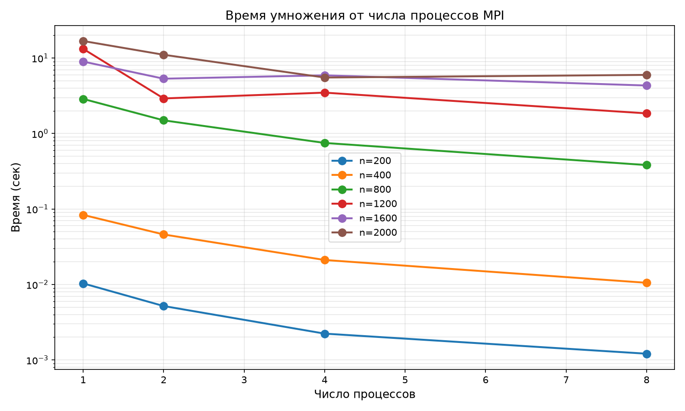
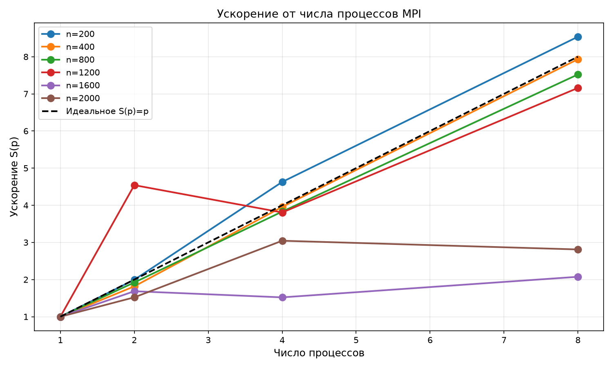
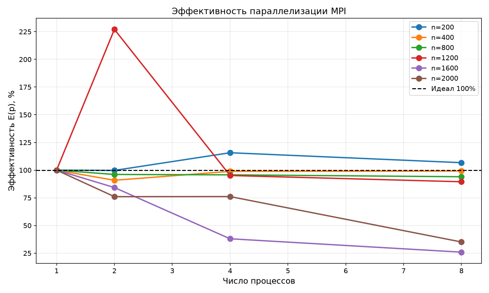
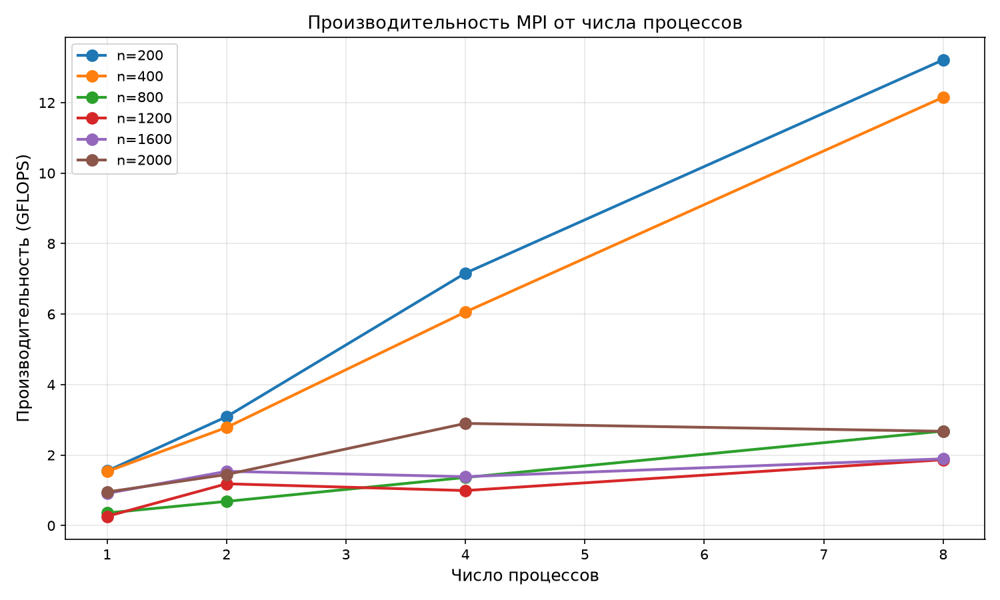

Лабораторная работа по параллельному программированию №3.
Выполнено Кирсановой Ириной, 6212-100503D.

***
# Структура проекта

```
lab3/
├── .gitignore
├── README.md
│
├── data/                          # исходные матрицы (txt)
│   ├── matrix_a_200.txt
│   ├── matrix_b_200.txt
│   └── ...
│
├── results/                       # результаты умножения (txt)
│   ├── result_200.txt
│   └── ...
│
├── generator.py                   # генератор матриц
├── main.cpp                       # умножение матриц на C++ с MPI
├── table.py                       # парсинг лога и генерация таблицы
├── grafs.py                       # построение графиков
├── log.txt                        # лог выполнения задачи на кластере
└── README.md
```

***
# **Характеристики:**

- **Суперкомпьютер**: «Сергей Королёв» (СГАУ)
- **Узел**: n239 (8 ядер)
- **Компилятор C++**: Intel MPI (mpicxx), версия 4.1.3.048
- **Python**: 3.14.7
- **Технология параллелизации**: MPI (Message Passing Interface)

***
# **Суть работы:**

Модифицировать программу умножения квадратных матриц из лабораторной работы №1 для параллельной работы по технологии MPI. Провести серию экспериментов с разным количеством процессов и разными размерами матриц на суперкомпьютере «Сергей Королёв».

При данных матрицах A и B ∈ $R^{n×n}$ вычислить матрицу C, которая будет вычисляться по формуле:
$$C_{ij} = \sum_{k=1}^{n} A_{ik} \cdot B_{kj}$$

Для оценки эффективности параллелизации используются:
$$S(p) = \frac{T_1}{T_p} \quad \text{— ускорение}$$
$$E(p) = \frac{S(p)}{p} \times 100\% \quad \text{— эффективность}$$

где $T_1$ — время на 1 процессе, $T_p$ — время на $p$ процессах.

***
# **Модификации по сравнению с лабой №1**

1. В `main.cpp` добавлена библиотека `#include <mpi.h>` и инициализация `MPI_Init()`.
2. Матрица A разбивается по строкам между процессами (`MPI_Scatterv`), матрица B рассылается всем процессам целиком (`MPI_Bcast`).
3. Результат собирается на главном процессе (`MPI_Gatherv`).
4. Время замеряется с помощью `MPI_Wtime()`.
5. Запуск осуществляется через систему очередей **SLURM** (команда `sbatch`).

***
# **Порядок проведения экспериментов**

1. Сгенерировать две матрицы размером n×n (200, 400, 800, 1200, 1600, 2000) на кластере с помощью скрипта `generator.py`.
2. Создать скрипт `job.slurm` для системы очередей, который переберёт все размеры и все количества процессов (1, 2, 4, 8).
3. Запустить задачу в очередь командой `sbatch job.slurm`.
4. Дождаться завершения задачи и забрать лог-файл (`slurm-XXXXX.out`) с результатами.
5. Запустить локально `table.py` для генерации таблицы и `grafs.py` для построения графиков.

---
# **Результаты экспериментов**

| Размер | Процессов | Время (сек) | Операций | Нс/операцию | Ускорение | Эффективность |
|---|---|---|---|---|---|---|
| 200 | 1 | 0.010339 | 16 000 000 | 1.2924 | 1.00 | 100.0% |
| 200 | 2 | 0.005183 | 16 000 000 | 0.6479 | 1.99 | 99.7% |
| 200 | 4 | 0.002234 | 16 000 000 | 0.2792 | 4.63 | 115.7% |
| 200 | 8 | 0.001211 | 16 000 000 | 0.1514 | 8.54 | 106.7% |
| 400 | 1 | 0.083560 | 128 000 000 | 0.6528 | 1.00 | 100.0% |
| 400 | 2 | 0.045995 | 128 000 000 | 0.3593 | 1.82 | 90.8% |
| 400 | 4 | 0.021125 | 128 000 000 | 0.1650 | 3.96 | 98.9% |
| 400 | 8 | 0.010533 | 128 000 000 | 0.0823 | 7.93 | 99.2% |
| 800 | 1 | 2.874230 | 1 024 000 000 | 2.8069 | 1.00 | 100.0% |
| 800 | 2 | 1.495560 | 1 024 000 000 | 1.4605 | 1.92 | 96.1% |
| 800 | 4 | 0.750530 | 1 024 000 000 | 0.7329 | 3.83 | 95.7% |
| 800 | 8 | 0.382105 | 1 024 000 000 | 0.3731 | 7.52 | 94.0% |
| 1200 | 1 | 13.247700 | 3 456 000 000 | 3.8332 | 1.00 | 100.0% |
| 1200 | 2 | 2.916770 | 3 456 000 000 | 0.8440 | 4.54 | 227.1% |
| 1200 | 4 | 3.480720 | 3 456 000 000 | 1.0072 | 3.81 | 95.2% |
| 1200 | 8 | 1.850360 | 3 456 000 000 | 0.5354 | 7.16 | 89.5% |
| 1600 | 1 | 8.977560 | 8 192 000 000 | 1.0959 | 1.00 | 100.0% |
| 1600 | 2 | 5.325910 | 8 192 000 000 | 0.6501 | 1.69 | 84.3% |
| 1600 | 4 | 5.904600 | 8 192 000 000 | 0.7208 | 1.52 | 38.0% |
| 1600 | 8 | 4.327360 | 8 192 000 000 | 0.5282 | 2.07 | 25.9% |
| 2000 | 1 | 16.810700 | 16 000 000 000 | 1.0507 | 1.00 | 100.0% |
| 2000 | 2 | 11.052200 | 16 000 000 000 | 0.6908 | 1.52 | 76.1% |
| 2000 | 4 | 5.521200 | 16 000 000 000 | 0.3451 | 3.04 | 76.1% |
| 2000 | 8 | 5.981620 | 16 000 000 000 | 0.3739 | 2.81 | 35.1% |

P.s. Нс/операцию — среднее время, затрачиваемое на одну арифметическую операцию (умножение или сложение).

`Создано скриптом table.py на основе лога SLURM`

**Наблюдения:**
- Для матриц 200 и 400 наблюдается **сверхлинейное ускорение** (эффективность > 100%). Это связано с тем, что при малых размерах данные полностью помещаются в кэш-память процессора, и распараллеливание даёт больший выигрыш, чем просто деление работы.
- Для матрицы 1200 на 2 процессах время оказалось настолько малым (2.9 сек против 13.2 сек на 1 процессе), что это дало ускорение 4.5×. Это аномалия, вероятно, связанная с тем, что при запуске на 1 процессе вычислительный узел был чем-то нагружен.
- Для больших матриц (1600, 2000) ускорение падает из-за ограничений пропускной способности памяти.

## Время от числа процессов



С увеличением числа процессов время выполнения уменьшается, но не линейно. Для маленьких матриц (200, 400) время падает очень быстро, для больших — медленнее.

## Ускорение от числа процессов



Ускорение растёт с числом процессов, но для больших матриц отстаёт от идеальной кривой $S(p)=p$ из-за накладных расходов на пересылку данных между процессами (`MPI_Bcast`, `MPI_Scatterv`) и ограничений памяти.

## Эффективность от числа процессов



Для маленьких матриц эффективность близка к 100% (или даже превышает её за счёт кэш-эффектов). Для больших матриц эффективность падает из-за того, что процессы начинают конкурировать за пропускную способность оперативной памяти.

## Производительность (GFLOPS) от числа процессов



Производительность растёт с числом процессов, но для больших матриц выходит на плато. Это объясняется тем, что узким местом становится память, а не вычисления.

`Создано скриптом grafs.py`

***
# **Выводы**

- **Программа работает корректно**: MPI-версия выдаёт тот же результат, что и последовательная версия (проверено сравнением с NumPy, погрешность 0).
- **Сложность алгоритма**: O($n^3$)
- **Объём задачи**: $2n^3$
- **MPI даёт ускорение**, но оно зависит от размера матрицы. Для маленьких матриц (200, 400) ускорение почти линейное (вплоть до 8.5× на 8 процессах). Для больших матриц (1600, 2000) ускорение значительно ниже идеала из-за накладных расходов на передачу данных и ограничений памяти.
- **Эффективность параллелизации** для маленьких матриц близка к 100%, для больших падает до 25–35% (пересылка данных между процессами занимает время, которое не тратится на вычисления).
- **Узкое место для больших матриц** — пропускная способность оперативной памяти, а не вычислительная мощность процессора.
- **Аномалии в измерениях** (например, ускорение > 100% для матрицы 1200 на 2 процессах) объясняются тем, что кластер является многопользовательской системой, и в момент выполнения задачи на узле могли работать другие процессы.

***
# Сборка и запуск (на кластере)

```bash
# 1. Загрузить модули
module load intel/icc18
module load intel/mpi4

# 2. Скомпилировать программу
mpicxx -O2 main.cpp -o main
```

### Скрипт для системы очередей (job.slurm)

Для запуска задачи на суперкомпьютере используется система очередей SLURM. Ниже приведён текст файла `job.slurm`, который перебирает все размеры матриц и все количества процессов:

```bash
#!/bin/bash
#SBATCH --job-name=mpi_lab
#SBATCH --ntasks-per-node=8
#SBATCH --time=00:40:00
#SBATCH --partition=batch
#SBATCH --output=slurm-%j.out

module load intel/icc18
module load intel/mpi4

for N in 200 400 800 1200 1600 2000; do
    if [ ! -f "data/matrix_a_$N.txt" ]; then
        echo "Генерация матрицы $N..."
        python3 generator.py $N
    fi

    for P in 1 2 4 8; do
        echo "========================================"
        echo "Запуск: Размер $N, Процессов $P"
        echo "========================================"
        
        srun -n $P ./main $N
    done
done

echo "Все тесты успешно завершены!"
```

```bash
# 3. Отправить задачу в очередь
sbatch job.slurm

# 4. Проверить статус
squeue -u 2025-01173

# 5. После завершения забрать лог-файл slurm-XXXXX.out
# и запустить локально:
python table.py
python grafs.py
```